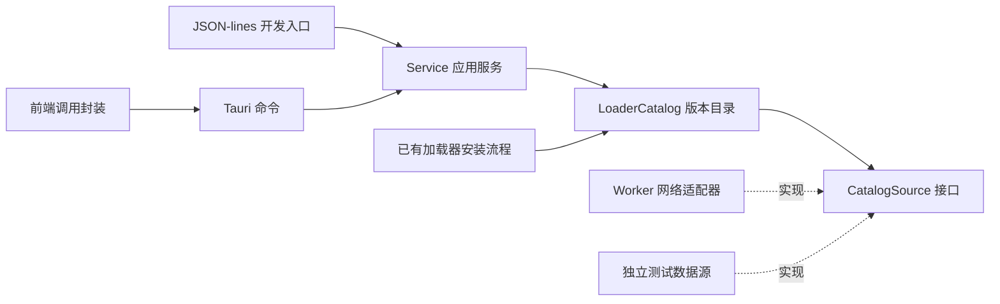

# 后端结构与接口

开发分工以 Rust 后端为主，前端仅维护必要的接口类型和调用封装。页面视觉与布局不在本轮修改范围。
后端逐步按对象职责拆分，使用结构体封装状态和方法、trait 定义边界，通过组合协作。
目前并未完成整个旧后端的重构。

## 加载器版本目录

`LoaderCatalog` 负责版本查询、去重、排序和推荐，不负责写配置、下载游戏或执行 Java。
`LoaderKind` 封装加载器种类与版本号规则，`LoaderRelease` 表示查询结果。
`CatalogSource` 是获取官方 JSON 元数据的接口；生产适配器由 `Worker` 实现，单元检查使用独立数据源。
目录对象不依赖安装器或界面。已有安装流程通过该对象选择默认版本，避免重复维护推荐规则。



Fabric 使用官方 `stable` 标记；Quilt 缺少该字段时按预发布后缀识别稳定版。
版本按数字段排序，不依赖官方返回顺序；优先推荐最新稳定版，无稳定版才回退最新版本。
Forge 从官方完整列表取版本，采用官方 recommended／latest；不在列表中的推荐项不作为可安装候选。
“最新”与“推荐”分别返回，不会把测试版默认为稳定版。

## 前端接入契约

Tauri：`api.loaderVersions(instanceId, 'fabric' | 'quilt' | 'forge')`。
JSON-lines：

```json
{"method":"loader_versions","id":"Vanilla Alias","loader":"quilt"}
```

结果字段：

| 字段 | 含义 |
| --- | --- |
| `instance_id` | 本次查询的本地实例名称，与全局已选实例分开 |
| `minecraft` | 解析得到的真实 Minecraft 版本，改名后的实例仍保持原版本 |
| `loader` | `fabric`、`quilt` 或 `forge` |
| `install_supported` | 当前安装入口是否通过基本适用性检查；不代表每个远端安装包已经验证 |
| `reason` | 无版本或安装入口不支持时的原因，否则为 null |
| `versions` | 按版本号从新到旧的数组；每项含 version、stable、recommended、latest |

查询不改变配置、当前实例或任务状态，不创建游戏文件。无效／不存在的实例在联网前报错。
Forge 安装入口仍要求 Java 17 及以上的现代基础版本；具体安装包还需经过原有格式、内容和哈希验证。
网络或远端格式错误返回错误，不能把它伪装成成功的空列表。

安装命令现在统一接受可选 `version`：

```json
{"method":"start_job","job":{"kind":"quilt","id":"Vanilla Alias","name":"My Quilt","version":"0.30.1"}}
```

不传 version 时自动推荐；旧调用保持兼容。指定版本仍需官方配置与基础游戏匹配，
已有同名实例拒绝覆盖。前端本轮只补充类型与方法，尚未新增版本选择页面。

## 验证范围

单元检查覆盖乱序与重复记录、稳定性冲突、数字排序、Forge 推荐记录缺失、无版本、
非法请求与远端元数据，以及 Service 在失败时不改变任务和配置。

主动联网验证：

```sh
cargo build --bin hmcl-service --no-default-features --locked
node scripts/test-loader-catalog-online.mjs
cargo test --lib --no-default-features --locked loaders::tests::official_loader_profiles -- --ignored
# 在先前由安装脚本创建的独立测试目录中，验证指定版本实际安装：
node scripts/test-install-online.mjs --fixture .tools/install-online-proof-xxxxxx --loader-versions
```

脚本创建手工实例元数据，通过真实 Service 查询官方接口，并独立核对推荐结果、原配置和任务状态。
结果保存于 `dist/loader-catalog-online-proof.json`。这不下载完整游戏、不执行 Java、不操控桌面，
不能代替加载器安装或真实游戏运行验收。

`--loader-versions` 则另外执行 Fabric／Quilt 实际依赖下载与指定版本安装，检查继承、
模组环境、有效启动参数及原客户端保留，不执行 Java 或游戏。

2026-10-21 的实际检查：73 项核心检查通过，4 项常规联网单元检查跳过；
另主动执行 Fabric／Quilt 官方推荐配置检查并通过，37 项界面检查通过。
通过真实 Service 查询 Minecraft 1.20.1 得到 Fabric 255 项、Quilt 307 项、Forge 137 项；
推荐值分别为 0.19.5、0.30.1、47.4.10，当时最新值分别为 0.20.1、0.31.0-beta.4、47.4.28。
这些值来自当时的官方接口，不能作为固定版本常量。
独立测试目录实际完成指定 Fabric 0.19.5 与 Quilt 0.30.1 安装，原客户端复用，既有实例配置保留。

官方元数据来源：
[Fabric](https://meta.fabricmc.net/v2/versions/loader/1.20.1)、
[Quilt](https://meta.quiltmc.org/v3/versions/loader/1.20.1)、
[Forge 完整列表](https://files.minecraftforge.net/net/minecraftforge/forge/maven-metadata.json)、
[Forge 推荐记录](https://files.minecraftforge.net/net/minecraftforge/forge/promotions_slim.json)。
